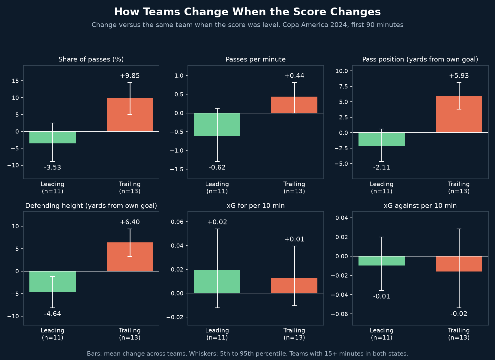
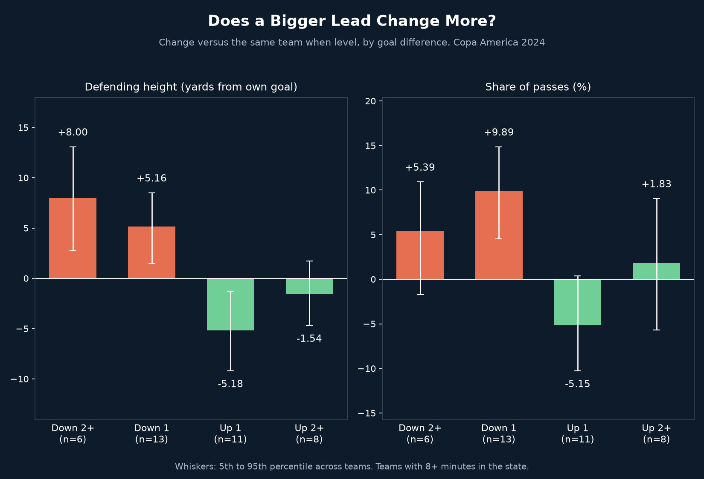

# Game State Effect

## Why
Football people say teams drop when they lead and push forward when they trail. But teams that lead often are usually the stronger teams, so comparing leading teams with trailing teams mixes tactics with quality. This project compares each team with itself when the score was level.

## What it does
- Tags every event in the first 90 minutes of Copa America 2024 (32 matches) with the score at that moment, from each team's side: leading, level or trailing
- Measures six things per team and state: share of passes, passes per minute, average pass position, height of defensive actions, and xG for and against per 10 minutes
- Takes each team's change from its own level-score value, averaged across teams with 15+ minutes in both states, with a 5th to 95th percentile range from 5,000 bootstrap resamples of the teams
- Repeats the check by exact goal difference (down 2+ to up 2+)
- Replays Argentina vs Canada: passes appear as the clock runs, with each team's average pass position tracked against the score

## Key findings

| Change vs the same team when level | Leading (11 teams) | Trailing (13 teams) |
|---|---|---|
| Share of passes (points) | -3.53 (-8.90 to +2.50) | +9.85 (+5.02 to +14.44) |
| Passes per minute | -0.62 (-1.29 to +0.12) | +0.44 (-0.00 to +0.81) |
| Pass position (yards from own goal) | -2.11 (-4.66 to +0.62) | +5.93 (+3.78 to +8.09) |
| Defending height (yards from own goal) | -4.64 (-8.14 to -1.20) | +6.40 (+3.25 to +9.38) |
| xG for per 10 min | +0.02 (-0.01 to +0.05) | +0.01 (-0.01 to +0.04) |
| xG against per 10 min | -0.01 (-0.04 to +0.02) | -0.02 (-0.05 to +0.03) |

- Trailing teams changed clearly: 92% of them had a higher share of passes, and their pass position moved 5.9 yards up the pitch
- Leading teams clearly changed one thing, how deep they defend (-4.6 yards, 73% of teams lower). Their changes in passing share and pass position are inside the noise
- Chances did not change. xG for and against stay within the ranges around zero in both states, so pushing up bought possession and territory but no measurable extra chances, and dropping deeper did not measurably raise xG conceded
- A bigger lead did not mean a bigger change. Defending height was -5.18 yards for teams up by 1 (11 teams) and -1.54 for teams up by 2+ (8 teams, range includes zero). Trailing grew with the deficit: +5.16 down 1, +8.00 down 2+ (6 teams)
- Argentina led for 221 minutes: passes per minute fell from 6.83 to 4.39, share of passes from 61.9% to 51.0%, pass position from 55.2 to 47.4 yards. They conceded less xG when leading (0.05 vs 0.07 per 10 minutes). Argentina had no trailing minutes in the first 90 minutes, so there is no trailing comparison for them

## Limitations
- 32 matches only. Eleven and thirteen teams are in the comparisons, so the ranges are wide
- Tactics are mixed with fatigue, substitutions and red cards, none of which are separated here
- Passes stand in for possession time
- Level includes early 0-0 minutes, when teams are cautious
- Time in a state is approximated from the gap between events
- Extra time and shootouts are excluded

## Visual

*Change versus the same team when the score was level. Whiskers show the 5th to 95th percentile across teams.*

*Defending height and share of passes by exact goal difference.*

`game_state_replay.mp4` replays Argentina vs Canada and ends with both charts.

## Tools
Python, pandas, NumPy, matplotlib, imageio-ffmpeg

## Data source
StatsBomb open data, Copa America 2024 (32 matches). First 90 minutes only.
